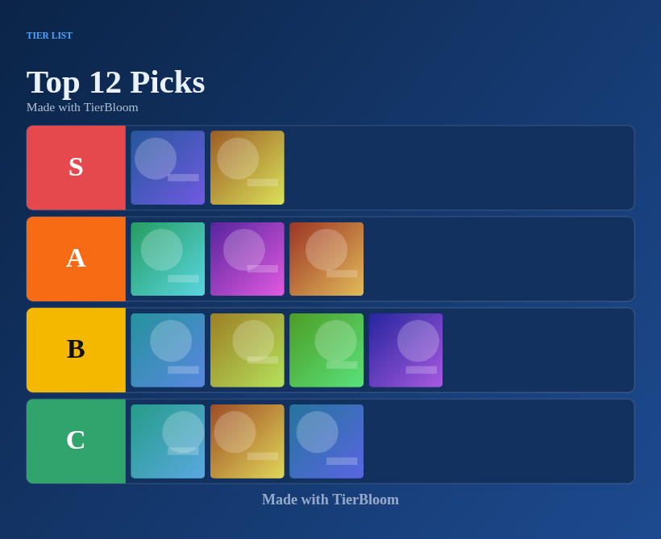
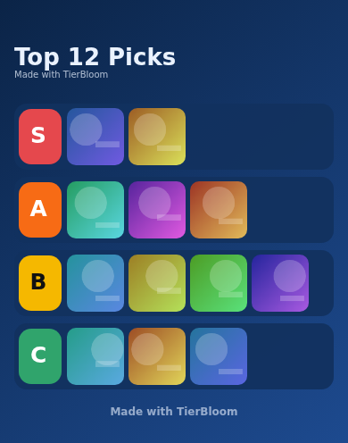
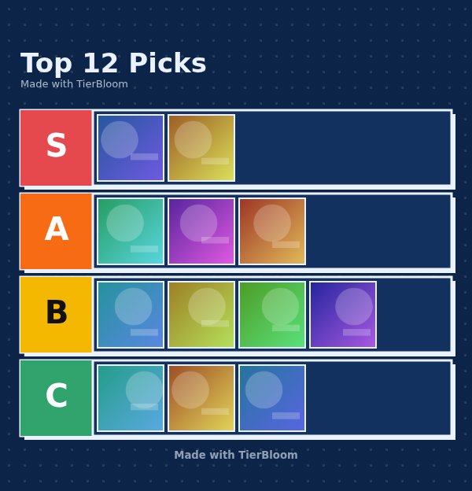
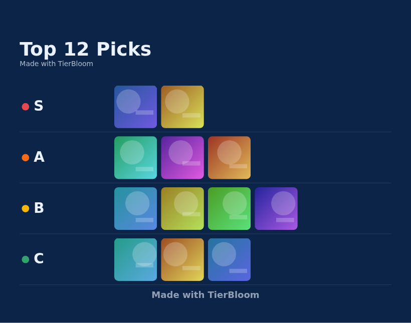
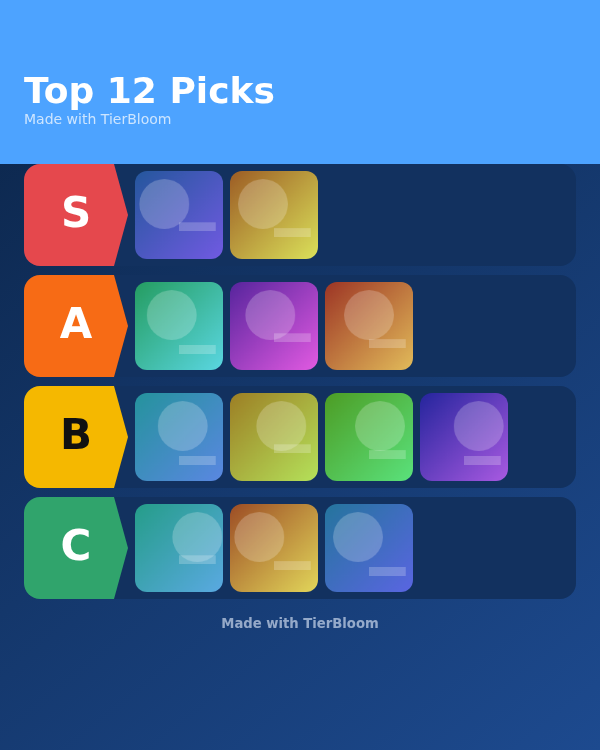
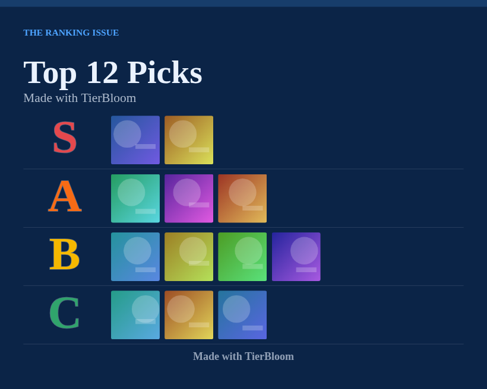
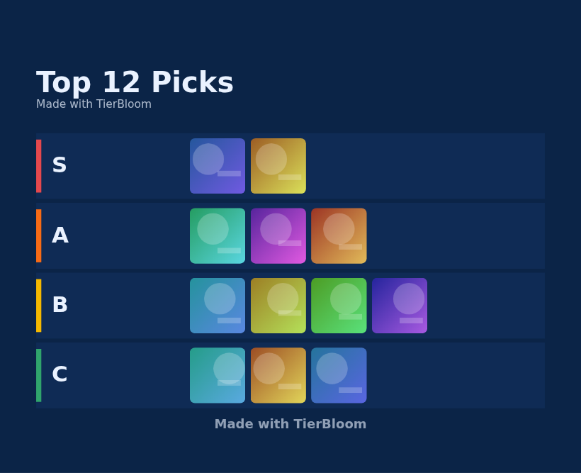
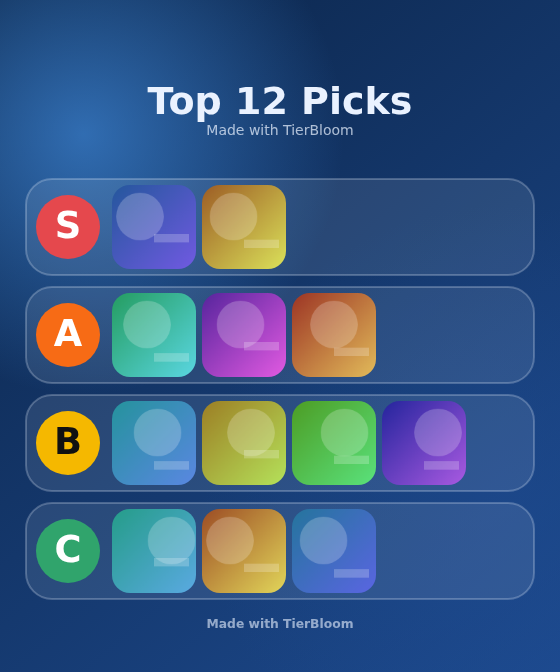
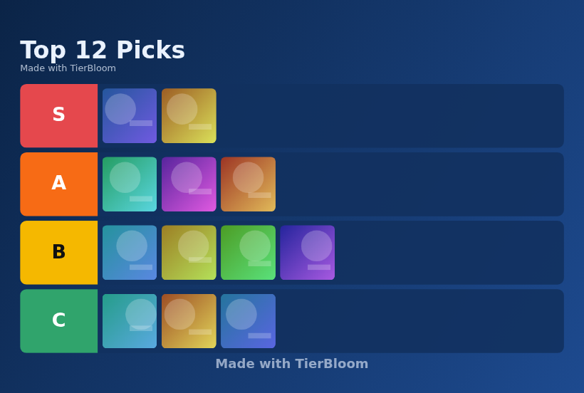

# Layout gallery

TierBloom ships with **19 export layouts**. Each one redraws labels, shapes, backgrounds and typography, so switching layouts changes the whole design, not just the colours. Every layout works with all **26 palettes**.

The previews below use the *Ocean Deep* palette and sample data.

| Preview | Layout | Category | Base width | Key |
|---|---|---|---|---|
|  | **Editorial** | Desktop | 1000 px | `ed` |
|  | **Story 9:16** | Social | 540 px | `story` |
|  | **Mobile** | Mobile | 390 px | `mobile` |
|  | **Square Block** | Social | 600 px | `square` |
|  | **Ledger** | Text | 1000 px | `ledger` |
|  | **Poster** | Social | 600 px | `poster` |
|  | **Blueprint** | Artistic | 1000 px | `blueprint` |
|  | **Magazine** | Text | 1000 px | `magazine` |
|  | **Typeset** | Text | 900 px | `typeset` |
|  | **Scoreboard** | Artistic | 1000 px | `scoreboard` |
|  | **Glass** | Social | 560 px | `glass` |
|  | **Landscape 16:9** | Desktop | 1280 px | `landscape` |
|  | **Desktop HD** | Desktop | 1920 px | `desktop` |
|  | **Widescreen Split** | Desktop | 1600 px | `split` |
|  | **Cinema** | Artistic | 1000 px | `cinema` |
|  | **Polaroid Wall** | Artistic | 1000 px | `polaroid` |
|  | **Gazette** | Text | 900 px | `news` |
|  | **Aurora 4:5** | Social | 1080 px | `aurora` |
|  | **Neon Arcade** | Artistic | 1000 px | `neon` |

## Choosing a layout

| You want to post on... | Try |
|---|---|
| Instagram or TikTok story | Story 9:16 |
| Instagram feed | Aurora 4:5, Square Block, Glass |
| A phone wallpaper or chat | Mobile |
| YouTube, a desktop wallpaper or a slide | Desktop HD, Widescreen Split, Landscape 16:9 |
| A blog, article or report | Editorial, Ledger, Gazette, Typeset |
| A fun, visual post | Polaroid Wall, Cinema, Neon Arcade, Scoreboard, Poster |
| Something technical | Blueprint |

## Layout options that apply to every layout

Title size, corner style, spacing, background pattern, item counts, rank numbers, image shadow, image borders, palette tier colours, subtitle and credit. See the [export guide](EXPORT_GUIDE.md).
